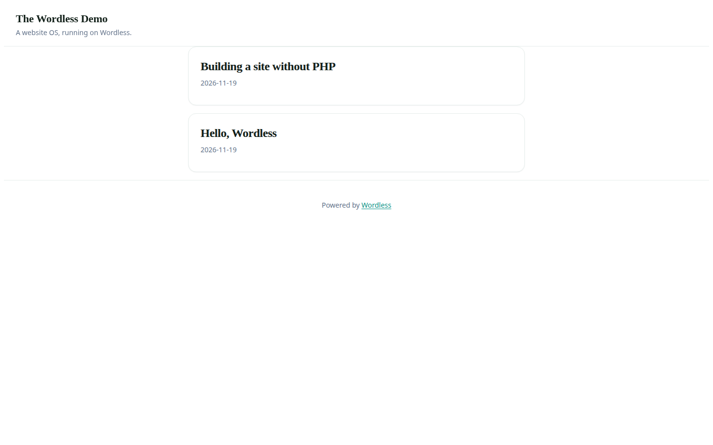

# Theme support (Milestone 5)

Wordless renders the public site through the **active theme**. Themes are
stored in D1 (`wl_themes`) with their files in R2 under `themes/<slug>/`.
The built-in **Wordless** default theme (an original block theme authored
for this project, `themes/wordless-default/`) is seeded lazily on a fresh
install and is active until another theme is activated. If no theme is
active, the M2 built-in rendering is used as a fallback (see
"Fallback" below).

*The public home page under the Wordless default theme.*

## theme.json support matrix

`theme.json` versions 1–3 are parsed and validated
(`src/modules/themes/themejson.ts`). Invalid files fail import with a
clear error listing the offending paths (e.g.
`settings.color.palette[0].color: missing required "color"`).

| Feature | v1 | v2 | v3 |
|---|---|---|---|
| `settings.color.palette` | ✓ | ✓ | ✓ |
| `settings.color.gradients` | ✓ | ✓ | ✓ |
| `settings.color.duotone` | ✓ | ✓ | ✓ |
| `settings.typography.fontSizes` (incl. fluid `clamp()`) | ✓ | ✓ | ✓ |
| `settings.typography.fontFamilies` | ✓ | ✓ | ✓ |
| `settings.typography.lineHeight`, `fontStyle`, `fontWeight`, `letterSpacing`, `textTransform`, `textDecoration` | ✓ | ✓ | ✓ |
| `settings.typography.writingMode` | — | ⚠ recorded, not applied | ✓ |
| `settings.spacing.spacingSizes` / `spacingScale` | ✓ | ✓ | ✓ |
| `settings.spacing.padding` / `margin` / `blockGap` / `units` | ✓ | ✓ | ✓ |
| `settings.layout.contentSize` / `wideSize` | ✓ | ✓ | ✓ |
| `settings.border` (color, radius, style, width) | ✓ | ✓ | ✓ |
| `settings.shadow` presets | ✓ | ✓ | ✓ |
| `settings.custom` | ⚠ recorded, not applied | ✓ | ✓ |
| `styles` (global: color, typography, spacing, border, shadow, filter, dimensions) | ✓ | ✓ | ✓ |
| `styles.elements` (link, heading, button, caption, cite) | ✓ | ✓ | ✓ |
| `styles.blocks.<block>` (global + per-block styles) | ⚠ per-block `elements` not applied | ✓ | ✓ |
| `styles.blocks.<block>.elements` | — | ⚠ recorded, not applied | ✓ |
| `customTemplates` | ⚠ recorded, not applied | ✓ (recorded) | ✓ (recorded) |
| `templateParts` | ⚠ recorded, not applied | ✓ (recorded) | ✓ (recorded) |
| `patterns` | ✓ (recorded) | ✓ (recorded) | ✓ (recorded) |
| `settings.appearanceTools`, `useRootPaddingAwareAlignments` | ✓ (parsed) | ✓ (parsed) | ✓ (parsed) |

✓ = implemented. ⚠ = parsed and validated, but the effect is recorded
in the import report's `unsupported` list rather than applied. `patterns`
in theme.json are recorded (the list names reusable fragments); the
fragments themselves render from the theme's `patterns/<name>.php`
files since 1.0.0 (M10) — see "Block patterns" below.

Version handling: the `version` field must be 1, 2 or 3; anything else
fails validation. A missing `version` defaults to 1 (WordPress behaviour).

## Generated stylesheet

`theme.json` generates real CSS served at `/theme.css`:

- **Custom properties** — `--wp--preset--color--<slug>`,
  `--wp--preset--font-size--<slug>`, `--wp--preset--font-family--<slug>`,
  `--wp--preset--spacing--<slug>`, `--wp--preset--gradient--<slug>`,
  `--wp--preset--shadow--<slug>`, `--wp--preset--duotone--<slug>`,
  `--wp--style--global--content-size` / `--wp--style--global--wide-size`,
  `--wp--custom--<key>` for `settings.custom` (v2/v3 only).
- **Fluid font sizes** — `fontSizes[].fluid: {min, max}` becomes
  `clamp(min, midpoint, max)`.
- **Global styles** — `body { … }` from `styles` (background, text colour,
  typography, spacing, border, shadow), `a { … }` from
  `styles.elements.link`, headings from `styles.elements.heading`, buttons
  from `styles.elements.button`.
- **Per-block styles** — `.wp-block-<name> { … }` from
  `styles.blocks["core/<name>"]` (the `core/` prefix is stripped).
- **Layout** — `main, .wp-site-blocks { max-width: var(--wp--style--global--content-size); … }`
  and `.alignwide { max-width: var(--wp--style--global--wide-size); }`.
- **Preset references** — `var:preset|color|<slug>` in styles resolves to
  `var(--wp--preset--color--<slug>)` (same for font-size, font-family,
  spacing, gradient, shadow, duotone).

The theme's own `style.css` is appended after the generated CSS, so a
theme's hand-written rules win over generated ones. The stylesheet is
hashed (cyrb53, 12 hex chars); every public page links
`/theme.css?v=<hash>` so activating a theme busts the cache. Theme CSS is
cached like other public assets.

## Block-theme rendering

Templates are the theme's `templates/*.html` files, rendered through the
M2 block renderer. Template hierarchy (first match wins):

| Request | Candidates |
|---|---|
| Home | `home.html`, `index.html` |
| Single post | `single.html`, `singular.html`, `index.html` |
| Page | `page.html`, `singular.html`, `index.html` |
| Term archive | `archive.html`, `index.html` |
| Search | `search.html`, `index.html` |
| 404 | `404.html`, `index.html` |

`index.html` is the final fallback. Template parts resolve from
`parts/<slug>.html` (`<!-- wp:template-part {"slug":"header"} -->`).
Supported template blocks: `group`, `columns`, `column`, `query`,
`post-template`, `post-title`, `post-content`, `post-excerpt`,
`post-date`, `post-terms`, `query-title`, `query-pagination`, `search`,
`navigation`, `site-title`, `site-tagline`, `paragraph`, `heading`,
`list`, `quote`, `image`, `code`, `separator`. `pattern` blocks render
the theme's `patterns/<name>.php` file (since 1.0.0 — see "Block
patterns" below). `post-featured-image` renders nothing (no
featured images yet). A missing template part is reported as a
warning, not a failure.

## Block patterns (1.0.0)

A `wp:pattern {"slug":"<theme>/<name>"}` block renders the theme's
`patterns/<name>.php` file: the leading PHP header comment (Title/Slug)
is stripped and the block HTML is rendered through the template
renderer, so query-loop patterns, nested patterns and patterns inside
template parts all work. Inline PHP inside a pattern file is evaluated
by an allowlisted evaluator (`src/modules/themes/pattern-php.ts`) that
handles the twelve i18n/escaping calls real themes use (`__`, `_x`,
`_e`, `esc_html__/_x/_e`, `esc_attr__/_x/_e`, `esc_url`,
`get_template_directory_uri`, `printf` with `%s`, `wp_kses_post`) with
string literals only. Anything else — variables, unknown functions,
includes, `eval`, control flow — refuses the whole pattern with a
warning; no PHP is ever executed. Nesting is bounded (depth 5, shared
with template parts) and a self-referencing pattern renders once
(cycle guard). One honest limit: `get_template_directory_uri()`
returns an empty string (theme files live in R2 with no public asset
URL yet), so image `src` attributes built from it are empty and the
renderer records one warning per page render. Verified against the
real Twenty Twenty-Five theme: its `home.html` (header/footer parts +
`template-query-loop` pattern) renders post titles and excerpts.

## Import guide

Admin → Themes → Import, or `POST /api/themes/import` (multipart `.zip`,
max 5 MB, `edit_theme_options` capability). The ZIP must contain
`style.css` (with a `Theme Name:` header) and `theme.json` at its root,
or inside a single top-level folder (stripped on import). Entries with
`..` or absolute paths are rejected. Files go to R2 under
`themes/<slug>/`; metadata (name, version, author, kind, theme.json,
stylesheet, hash, import report) goes to `wl_themes`.

- **Block themes** — validated, activated with
  `POST /api/themes/:slug/activate`. The active theme renders the public
  site immediately.
- **Classic themes** — use `POST /api/themes/import-classic` instead (see
  `classic-conversion.md`). Their stylesheet is used; PHP templates are
  analysed, never executed.
- **Delete** — `POST /api/themes/:slug/delete` refuses the active theme
  and the built-in default.

## Customizer (visual editor v1)

Admin → Themes → Customizer edits the **active block theme's**
`theme.json` settings through form controls: colour palette entries,
font sizes, font families, spacing scale, content/wide widths.

- **Preview** — `POST /api/themes/preview` stores the unsaved settings
  under a short-lived token (30 minutes) in the `wl_theme_preview`
  option; the preview iframe loads `/?wl_preview=<token>`, which the
  server renders with those overrides. Preview renders are never cached
  and nothing is injected into the page with JavaScript.
- **Save** — `PUT /api/themes/:slug/variation` stores the settings as a
  variation in the `wl_theme_variation_<slug>` option; it is merged over
  the theme's `theme.json` (preset arrays merge by slug) on every render
  and in `/theme.css`.
- **Reset** — `DELETE /api/themes/:slug/variation` removes the variation;
  the theme renders with its own `theme.json` again.

Full site-template editing is **out of scope for v1** — templates are
changed by importing a new theme version.

## Fallback

When no theme is active (e.g. the active theme row was deleted while
another theme is active is impossible — delete refuses the active theme;
the fallback exists for a fresh DB before the first seed), the M2
built-in rendering is used: the same home/single/page/archive/search
pages with the M2 inline layout and no `/theme.css` link.

## Compat functions (M5)

| WordPress function | Level | Notes |
|---|---|---|
| `get_theme_root()` | partial | Returns the R2 prefix `themes/` (no filesystem path exists on Workers) |
| `wp_get_theme($slug?)` | partial | Active theme (or the named one): slug, name, version, author, status, kind. No `WP_Theme` object extras |
| `get_stylesheet()` | partial | Active theme slug; its stylesheet is at `/theme.css` |
| `get_template()` | partial | Same as `get_stylesheet` in v1 — no parent/child theme hierarchy yet |

The compat registry is now 45 functions (41 in M4 + 4 theme functions).
